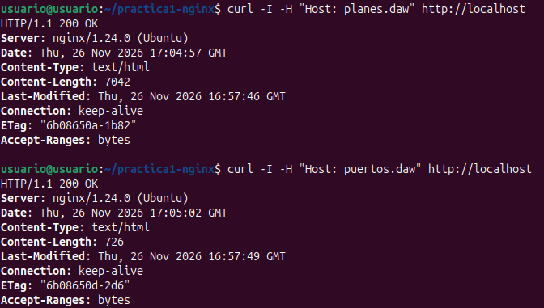
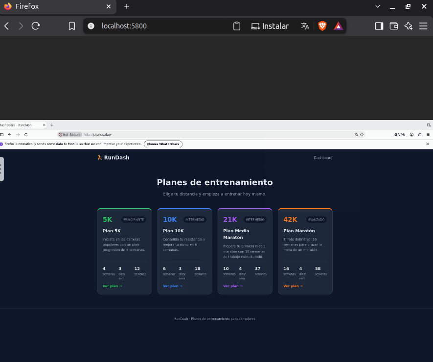
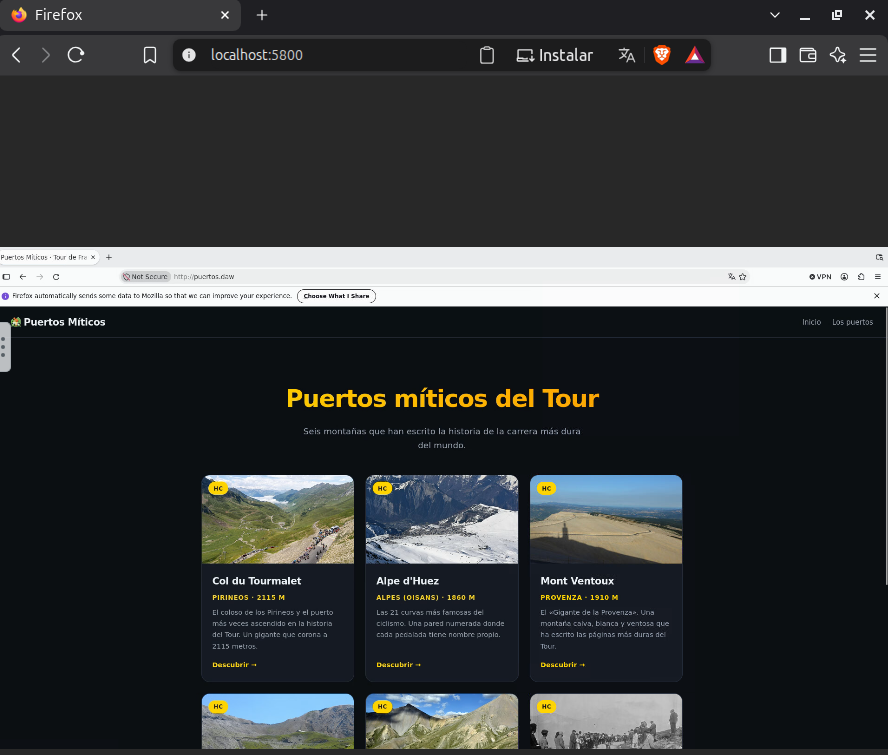
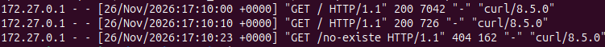

# Ejercicio Nginx 1
## Captura 1
Se me ha olvidado hacerle captura a la salida del comando nginx -t y ss -tlnp | grep :80, pero vaya al final comprueban que el servidor se enciende y escucha en el puerto 80, así que de igual forma se demuestra en las siguientes capturas.

## Captura 2

## Captura 3 y 4

## Captura 5

